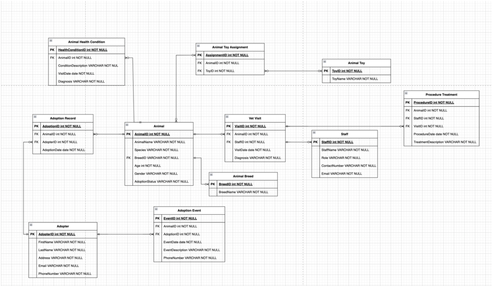
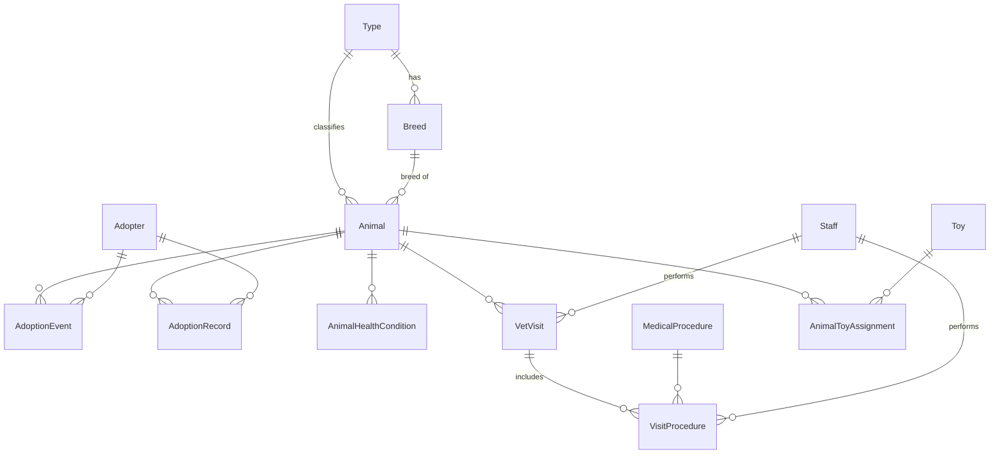

# Animal Shelter Management Database

[](https://github.com/Afloriea/Animal-Shelter-SQL-Management/actions/workflows/build.yml)

A SQL Server database for running an animal shelter: animal profiles, adopters, adoptions, health records, enrichment toys, staff and veterinary care. Business rules are enforced in the database with triggers, common workflows are wrapped in stored procedures, and every push rebuilds the whole database on SQL Server 2022 in GitHub Actions.

**Skills shown:** relational modelling · T-SQL · stored procedures · triggers · computed columns · CTEs and window functions · Docker · CI for database scripts

---

## 📌 At a glance

| | |
|---|---|
| **Data model** | 13 tables in 5 areas (animals, adoption, health, staff, enrichment), with an ERD |
| **Database logic** | 2 stored procedures, 2 triggers enforcing adoption rules, 2 computed columns, 3 analytical queries |
| **Quality** | The full build runs on SQL Server 2022 in CI on every push; 6 bugs found and fixed along the way |
| **Context** | Final project for IMT 543 ([presentation slides](docs/presentation.pdf)), later tested and refactored |

---

## 🎯 Problem

Shelter data tends to live in spreadsheets: which animals are available, who adopted whom, which vet saw which animal and what was done. Records drift out of sync and simple questions take manual work. This project puts that data in one schema with the rules built in, so an animal can't be adopted twice and adoption status updates itself.

---

## 🗂 Data model

13 tables in five areas:

| Area | Tables |
|---|---|
| **Animals** | `Animal`, `Type`, `Breed` |
| **Adoption** | `Adopter`, `AdoptionEvent`, `AdoptionRecord` |
| **Health** | `AnimalHealthCondition`, `VetVisit`, `MedicalProcedure`, `VisitProcedure` |
| **Staff** | `Staff` |
| **Enrichment** | `Toy`, `AnimalToyAssignment` |

### Entity-Relationship Diagram (ERD)



The ERD was drawn before `Animal.BreedID` was added (see [Testing](#-testing-what-ci-caught)). The diagram below reflects the current schema.

<details>
<summary>Current schema as a diagram (includes <code>Animal.BreedID</code>)</summary>



</details>

---

## 🛠 Database objects

### Stored procedures
- **`SendAdoptionNotification`** builds the confirmation message for an adoption from the adopter's and animal's records.
- **`GetAvailableAnimals`** lists every animal that is available for adoption, with its type and breed.

### Triggers on `AdoptionEvent`
- **`CheckAdoptedAnimal`** rejects an adoption if the animal isn't a dog or cat, or has already been adopted. It is set-based, so multi-row inserts are checked row by row. It is set to fire first so it sees the status before it changes.
- **`UpdateAdoptionStatus`** marks the animal as `Adopted` once the event is recorded.

```sql
-- From CheckAdoptedAnimal: checks every inserted row, not just one
IF EXISTS (
    SELECT 1
    FROM inserted i
    JOIN Animal a ON a.AnimalID = i.AnimalID
    WHERE a.AdoptionStatus = 'Adopted'
)
    THROW 50002, 'This animal has already been adopted.', 1;
```

### Computed columns on `Animal`
- **`FullName`**, for example "Whiskers the Cat".
- **`IsSenior`**: `Yes` when the animal is 8 or older.

### Analytical queries
- Adoption count and average age by animal type
- Latest health condition for each animal (`ROW_NUMBER`)
- Vet history for adopted animals: visit count, latest visit, latest diagnosis and staff member (CTE + window functions)

---

## 📊 Sample output

These results come from the CI run on SQL Server 2022 against the sample data.

**Available animals** (`EXEC GetAvailableAnimals`)

| AnimalID | Name | Type | Breed | Age | Gender |
|---|---|---|---|---|---|
| 1 | Whiskers | Cat | Siamese | 2 | Female |
| 3 | Mittens | Cat | Persian | 1 | Male |
| 4 | Luna | Dog | Golden Retriever | 2 | Female |
| 6 | Max | Dog | German Shepherd | 1 | Male |
| … | | | | | |

10 rows in total.

**Business rule in action**

```
INSERT INTO AdoptionEvent(AnimalID, AdopterID, EventDate) VALUES (3, 2, '2024-03-20');
Rejected: This animal has already been adopted.
```

**Adoptions by type**

| AnimalType | AdoptionCount | AverageAdoptedAge |
|---|---|---|
| Cat | 8 | 2.3 |
| Dog | 7 | 3.1 |

**Vet history of adopted animals** (top 3)

| Animal | Age | Visits | Latest visit | Diagnosis | Staff |
|---|---|---|---|---|---|
| Rocky (Dog) | 4 | 1 | 2024-10-12 | Dental Surgery | Dr. Harris |
| Milo (Cat) | 2 | 1 | 2024-06-15 | Gastric Ulcer | Nurse Moore |
| Bella (Cat) | 3 | 1 | 2024-03-12 | Skin Allergy | Dr. Taylor |

---

## 🧪 Testing: what CI caught

Building the database from scratch on a clean SQL Server instance in CI surfaced six bugs in the original script. Each one was fixed in its own pull request:

| Problem | Effect | Fix |
|---|---|---|
| No `GO` between procedures and triggers | Script stopped with Msg 134 and could not run end to end | Batch separators |
| `Animal` had no breed, so the procedure joined `Breed` on `TypeID` | Each available animal was listed 5 times (50 rows for 10 animals) | `Animal.BreedID` foreign key |
| `Type` seeded Cat/Dog five times | Duplicate lookup rows | Two rows plus `UNIQUE` |
| Trigger read one row into a variable, and a second trigger duplicated the first | Multi-row inserts only partly checked; repeat adoptions allowed | Set-based check with `THROW`, duplicate removed |
| Overall average age stored in an `INT` | Both types showed the same, truncated value (2) | Per-type `AVG` as a decimal |
| "Most severe condition" kept one row overall | Returned a single animal | Latest condition per animal with `ROW_NUMBER` |

---

## ▶️ Run it locally

SQL Server runs in Docker, so nothing needs to be installed except Docker Desktop.

**1. Start SQL Server 2022 in a container**

```bash
docker run -d --name animal-shelter-db   -e ACCEPT_EULA=Y -e "MSSQL_SA_PASSWORD=<YourStrong!Passw0rd>"   -p 1433:1433 -v "$PWD/sql:/sql"   mcr.microsoft.com/mssql/server:2022-latest
```

On an Apple Silicon Mac, turn on *Use Rosetta for x86/amd64 emulation* in Docker Desktop first. The SQL Server image is x86 only.

**2. Create the database and run the scripts in order**

```bash
SQLCMD="docker exec animal-shelter-db /opt/mssql-tools18/bin/sqlcmd -C -S localhost -U sa -P <YourStrong!Passw0rd>"
$SQLCMD -Q "CREATE DATABASE AnimalShelter"
for f in sql/*.sql; do $SQLCMD -d AnimalShelter -b -i "/$f"; done
```

The order is `01_schema` → `02_seed_data` → `03_procedures` → `04_triggers` → `05_computed_columns` → `06_queries`.

**3. Explore**

Connect a SQL client to `localhost,1433` as `sa`. The project was built on macOS with Azure Data Studio; SSMS or the VS Code mssql extension work too. Then try `EXEC GetAvailableAnimals;` or the queries in `06_queries.sql`.

The [CI workflow](.github/workflows/build.yml) runs the same steps on every push.

## 🧭 Limitations and next steps

- `AdoptionEvent` and `AdoptionRecord` overlap. In the sample data they don't always agree with each other or with `Animal.AdoptionStatus`. Merging them into one table, with the status derived from it, is the next step.
- `SendAdoptionNotification` only prints the message. A real shelter would queue an email.
- The sample data is small and synthetic: 15 animals, 15 adopters, 15 staff.

## 💻 Tech stack

SQL Server 2022 · T-SQL · Docker · Azure Data Studio · GitHub Actions · Mermaid
